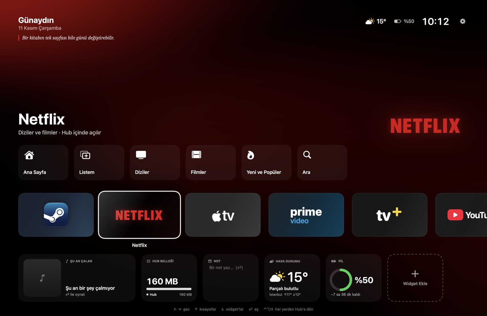

# Hub

> A full-screen, TV-style home screen for macOS: launch apps and streaming services from one place, with live widgets, keyboard and gamepad navigation. Native SwiftUI + Liquid Glass, macOS 26+.

MacBook için TV ana ekranı gibi tam ekran bir başlatıcı. Steam, Netflix, Apple TV, Prime Video, TV+, YouTube, Twitch, Spotify ve Reddit tek ekranda; altında canlı widget'lar. Klavye, fare ya da Xbox/PlayStation kumandasıyla kullanılır.



## Özellikler

- **TV gibi ana ekran:** Seçili uygulamanın renklerine bürünen canlı arka plan, büyük görseli ve kısayol rafı (Netflix'te Listem/Diziler, Steam'de yüklü oyunlar ve Big Picture, Spotify'da çalan şarkı…).
- **Web servisleri Hub içinde:** Netflix, TV+, YouTube, Twitch, Reddit tam ekran açılır; ana ekrana dönünce kaldığın yerden devam eder ya da tek tuşla kapatılır. İstersen varsayılan tarayıcıda açılır.
- **Widget'lar:** Saat, hava durumu (Open-Meteo), Spotify'da çalan, Steam oyunları, pil, Hub'ın bellek kullanımı, not, takvim. Ekle, kaldır, sırala.
- **Günün sözü:** Selamlamanın altında her gün değişen kısa bir söz.
- **Kumanda desteği:** D-pad / sol çubukla gez, A seç, B geri.
- **Her yerden çağır:** ⌃⌥H ile Hub öne gelir; başka bir uygulamaya geçince arkada görünmez.

## Gereksinimler

- macOS 26 veya üstü
- Xcode 26 veya üstü (Swift 6.2)

## Kurulum

```bash
git clone https://github.com/weaglf/mac-hub.git
cd mac-hub
./build.sh install   # derler, /Applications/Hub.app olarak kurar ve açar
```

Diğer komutlar:

```bash
./build.sh run      # derle ve geliştirme kopyasını aç (build.noindex/Hub.app)
./build.sh          # sadece derle
swift Scripts/make-icon.swift Resources   # ikonu yeniden çiz
```

Uygulama ad-hoc imzalıdır (geliştirici hesabı gerekmez). Kendi Mac'inde derlediğin için Gatekeeper uyarısı çıkmaz.

## Kullanım

| Tuş | Ne yapar |
| --- | --- |
| ← → | Uygulamalar / kısayollar / widget'lar arasında gez |
| ↑ | Odaklanan uygulamanın kısayollarına çık |
| ↓ | Widget satırına in |
| ⏎ / boşluk | Aç |
| esc | Geri |
| ⌫ | Odaklanan widget'ı kaldır |
| ⌥← ⌥→ | Widget'ı taşı |
| ⌘N | Widget ekle |
| ⌘, | Ayarlar |
| ⌘W | Web servisinden ana ekrana dön (arka planda açık kalır) |
| ⇧⌘W | Web servisini kapat ve ana ekrana dön |
| ⌃⌥H | Her yerden Hub'ı öne getir |

**Fare:** Tıklama seçer, seçili öğeye tekrar tıklamak (ya da çift tıklamak) açar. Satırları kaydırmak için fareyi ekranın sol ya da sağ kenarına dayayın.

**Kumanda (Xbox/PS):** D-pad/sol çubuk gez, A seç, B geri, X widget kaldır, L1/R1 widget taşı.

## Notlar

- **Spotify:** Çalan şarkı izinsiz gelir. Oynat/duraklat ilk kullanımda macOS'un "Hub, Spotify'ı denetlemek istiyor" iznini ister.
- **Web servisleri:** Sayfalar Safari'nin motoru WebKit ile açılır; girişler Hub'a aittir ve kalıcıdır. Bir servis Hub içinde sorun çıkarırsa Ayarlar'dan "Varsayılan tarayıcıda"ya geçebilirsin.
- **Bellek widget'ı:** Web sayfalarının çalıştığı WebKit süreçlerini Hub'a bağlamak için Etkinlik Monitörü'nün de kullandığı belgelenmemiş sistem işlevlerini (`responsibility_get_pid_responsible_for_pid`, `WKWebView._webProcessIdentifier`) kullanır; bulunamazsa yalnızca Hub'ın kendi belleği gösterilir.
- **Ayarlar dosyası:** `~/Library/Application Support/Hub/config.json`
- Netflix, Apple TV, Prime Video, TV+, YouTube, Twitch, Spotify, Steam ve Reddit adları ve renkleri sahiplerine aittir; bu proje onlarla bağlantılı değildir.

## Lisans

[MIT](LICENSE)
